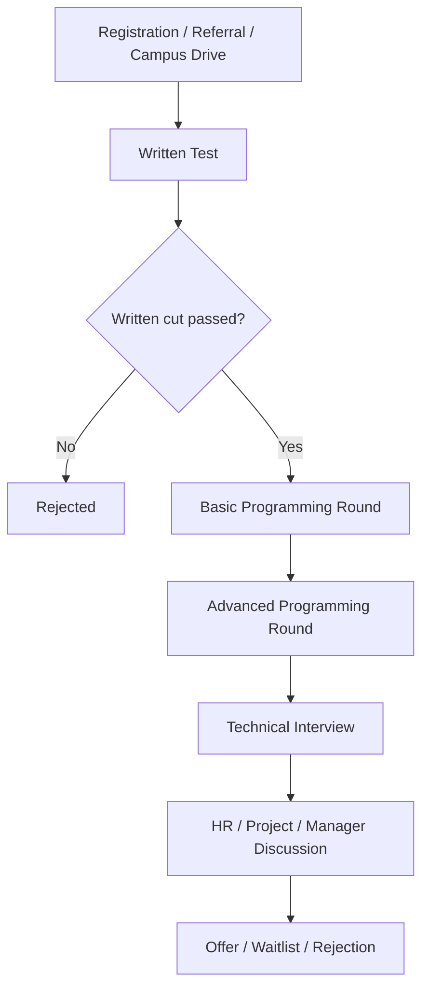
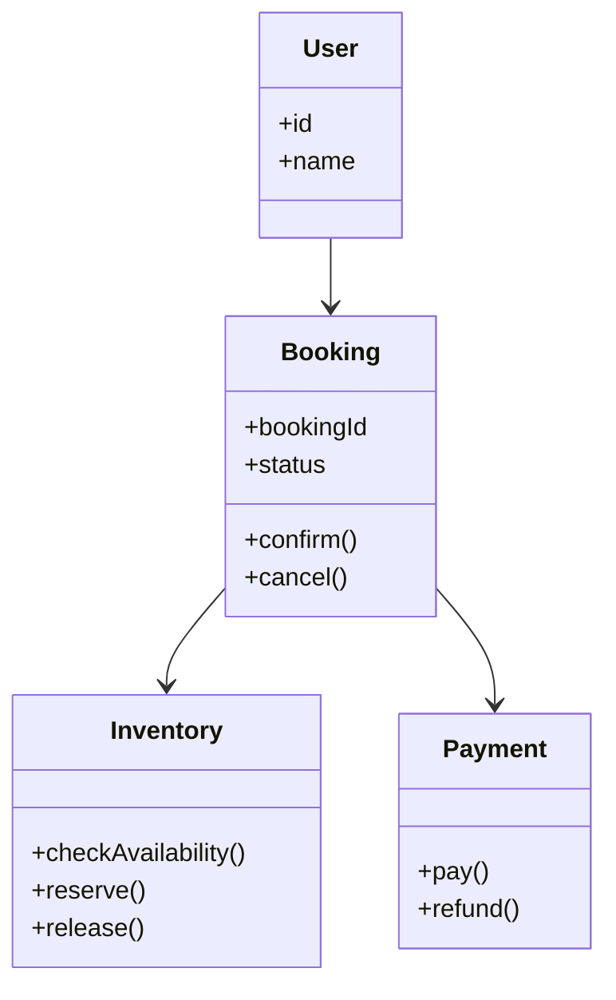

# Zoho Preparation Bible 2027

> A technical interview handbook for Zoho Software Developer campus and off-campus preparation.

---

## Copyright

Copyright (c) 2026-2027.

All rights reserved.

This handbook is an original preparatory work assembled from publicly available interview patterns, candidate reports, and original practice material. Where a question or pattern is not directly verifiable from a public report, it is explicitly labeled as **Reconstructed from multiple interview experiences** or **Practice Question**.

---

## Preface

Zoho interviews reward candidates who can move quickly across three layers at once:

1. Solve basic aptitude without wasting time.
2. Read and reason about C/C++ code at the level of the compiler and runtime.
3. Write clean programs under time pressure and then defend the design choices in technical rounds.

This book is written for BE/BTech students preparing for Zoho campus hiring, off-campus drives, and role-specific technical interviews. It is not a rumor digest. It is a preparation manual that turns reported patterns into structured practice.

Publicly reported sources consulted for pattern extraction include LeetCode Discuss, Glassdoor, Reddit r/Zoho, PrepInsta, FACE Prep, PlacementPreparation.io, and GeeksforGeeks. When a detail is taken from a public report, the source is named in the text. When a pattern is synthesized from multiple accounts, it is marked as reconstructed.

---

## How to Use This Book

Read it in four passes:

1. First pass: learn the process, pattern, and common traps.
2. Second pass: solve the output questions and aptitude questions under a timer.
3. Third pass: write the coding problems yourself and compare against the solutions.
4. Fourth pass: rehearse the technical interview and HR answers out loud.

Use this sequence for each chapter:

1. Read the concept.
2. Solve the question without looking.
3. Check the dry run.
4. Review the common mistake.
5. Reattempt the variation.

> **Tip**: In Zoho-style rounds, speed matters, but blind speed is punished more than careful speed. The real goal is to preserve correctness while keeping a low editing footprint in your head.

> **Warning**: Do not memorize answers without understanding the control flow. The same pattern is often asked with a changed variable name, a different loop condition, or a small pointer twist.

---

## Table of Contents

1. [Complete Recruitment Process](#complete-recruitment-process)
2. [Part 1: Level 1 Written Test](#part-1-level-1-written-test)
   1. [Chapter 1: Latest Hiring Pattern](#chapter-1-latest-hiring-pattern)
   2. [Chapter 2: Programming Output Questions](#chapter-2-programming-output-questions)
   3. [Chapter 3: Programming MCQs](#chapter-3-programming-mcqs)
   4. [Chapter 4: Aptitude](#chapter-4-aptitude)
   5. [Chapter 5: Revision Notes](#chapter-5-revision-notes)
   6. [Chapter 6: 20 Mock Tests](#chapter-6-20-mock-tests)
3. [Part 2: Programming Round](#part-2-programming-round)
4. [Part 3: Advanced Programming Round](#part-3-advanced-programming-round)
5. [Part 4: Technical Interview](#part-4-technical-interview)
6. [Part 5: HR Interview](#part-5-hr-interview)
7. [Part 6: Interview Experiences](#part-6-interview-experiences)
8. [Part 7: Resources](#part-7-resources)
9. [Appendix](#appendix)

---

## Complete Recruitment Process

Zoho hiring is not perfectly uniform across years, cities, and role types. However, the recurring structure is clear.

### 2026 Pattern

Recent 2026 public reports show a common written-test pattern of roughly 10 aptitude questions and 10 C/C++ or programming questions in the first round, often under a one-hour limit. This was explicitly echoed in public snippets from LeetCode Discuss, Reddit r/Zoho, PrepInsta, FACE Prep, and GeeksforGeeks. Follow-up rounds then move into basic programming, advanced programming, technical discussion, and HR.

### 2025 Pattern

Publicly reported 2025 experiences suggest a similar but slightly more variable structure:

1. Written test with aptitude plus programming.
2. One or two programming rounds.
3. Technical interview.
4. HR or project discussion.

Some candidate reports mention a larger written set such as 20 questions, while others mention 10 aptitude and 10 programming questions. The safest interpretation is that Zoho adapts the assessment by role, location, and hiring channel.

### Historical Evolution

The older pattern, especially from earlier on-campus and off-campus reports, tends to emphasize:

1. Basic aptitude.
2. C output or C program tracing.
3. One or more coding tasks.
4. Depth check on fundamentals in the technical rounds.

Over time, the center of gravity has shifted toward practical coding and problem-solving while keeping a strong foundation in C/C++ syntax, output prediction, and time-pressure aptitude.

### Campus

Campus drives commonly front-load the first screening round. The written test usually acts as the filter, and the interview rounds verify whether the candidate can reason through code instead of only recognizing answers.

### Off Campus

Off-campus reports frequently mention a broader funnel, more applicants, and more emphasis on written filtering before the candidate is allowed into coding and technical rounds. Some reports also mention role-specific variation such as Java, full stack, QA, debug engineering, or cloud operations.

### End-to-End Flow



> **Interview Note**: The pattern can compress or expand. Some role-specific drives stop after fewer rounds; some add extra live debugging or design discussion. The written test remains the most common first gate.

---

# Part 1

## Level 1 Written Test

## Chapter 1: Latest Hiring Pattern

Public reports from 2024-2026 point to a consistent reality: Zoho’s first round is less about difficult theory and more about disciplined fundamentals under time pressure.

### Difficulty

The first round is usually described as easy-to-moderate in isolation but tricky in aggregate because the time limit is tight and the question mix is broad. Many candidates can solve individual questions, but the full paper becomes demanding when they lose time on a single output-tracing question.

### Selection Ratio

There is no universal public ratio, but the recurring pattern is clear: the written test eliminates a large portion of the applicant pool. Public snippets from Glassdoor and Reddit indicate the funnel is narrow enough that even strong coders can be filtered out if they are slow on aptitude or low-level tracing.

### Cutoffs

No official public cutoff is consistently disclosed. The practical cutoff is usually behavioral:

1. Attempt most questions.
2. Avoid obvious arithmetic mistakes.
3. Do not miss the easy programming traces.
4. Show enough completeness to be shortlisted for the next round.

### What the First Round Tests

The first round is typically trying to answer four questions about you:

1. Can you compute quickly?
2. Can you read C/C++ code like a machine would?
3. Can you handle variable updates, scope, and pointer semantics?
4. Can you keep your output stable when the paper becomes repetitive or slightly adversarial?

### Tips

1. Memorize C operator precedence and the post-increment / pre-increment behavior.
2. Practice output prediction on arrays, pointers, strings, recursion, and bitwise operations.
3. Read every line of an MCQ slowly; Zoho likes small twists.
4. If a question has nested loops, write the values after each iteration.
5. Use elimination aggressively in aptitude.

### Mistakes

1. Treating `=` and `==` casually.
2. Ignoring integer division.
3. Forgetting that arrays decay to pointers in function parameters.
4. Assuming `printf` and `cout` behave the same way under undefined behavior.
5. Spending too much time on a single puzzle and losing the rest of the paper.

> **Warning**: Many aspirants prepare only for DSA-style coding and underprepare for low-level output prediction. That is a mistake in Zoho hiring because the written round often includes exactly this style of question.

### What Verified Public Reports Say

* LeetCode Discuss, 9 Feb 2026: a fresher report described “10 Aptitude and 10 Programming questions” in one hour.
* LeetCode Discuss, 2025 off-campus experience snippets: candidates reported 20 questions in total with aptitude plus programming.
* Reddit r/Zoho, 2025 threads: users reported written tests of “aptitude 10 and programming 10” and another pattern of coding basics followed by advanced DSA.
* PrepInsta 2026 snippets: written test pages mention aptitude plus C questions, basic programming, advanced programming, and technical interview.
* FACE Prep 2026 snippets: patterns vary from 3–4 technical rounds plus HR to 5–7 rounds including written, two programming rounds, technical interview, and HR.

### Reconstructed Hiring Pattern

From the public reports, the most stable reconstruction is:

1. Written screening: aptitude + C/C++ output or MCQ.
2. Basic programming round.
3. Advanced coding or DSA round.
4. Technical discussion.
5. HR and fit discussion.

---

## Chapter 2: Programming Output Questions

The following questions are original practice items designed to match the style seen in public Zoho reports. When the pattern is directly mirrored from those reports, it is labeled as **Verified Public Interview Report** or **Reconstructed from Multiple Reports**. Otherwise it is a **Practice Question**.

### Topic 1: Variables and Scope

#### Q001

| Field | Value |
|---|---|
| Difficulty | Easy |
| Topic | Variables |
| Question Number | 1 |
| Source | Practice Question |
| Code |

```c
#include <stdio.h>
int main() {
    int a = 10;
    int b = a + 5;
    printf("%d %d", a, b);
    return 0;
}
```

| Field | Value |
|---|---|
| Correct Output | `10 15` |
| Dry Run | `a=10`, `b=15`, both printed in order. |
| Explanation | `b` is computed from `a` before printing; there is no mutation. |
| Time Complexity | O(1) |
| Common Mistakes | Thinking `b` changes when `a` is printed. |
| Interview Tips | Start with deterministic questions to build confidence. |
| Variation | Replace `a + 5` with `a++ + 5`. |
| Expected Follow-up Question | What is the difference between pre-increment and post-increment? |

#### Q002

| Field | Value |
|---|---|
| Difficulty | Easy |
| Topic | Scope |
| Question Number | 2 |
| Source | Reconstructed from Multiple Reports |
| Code |

```c
#include <stdio.h>
int x = 7;
int main() {
    int x = 3;
    printf("%d", x);
    return 0;
}
```

| Field | Value |
|---|---|
| Correct Output | `3` |
| Dry Run | Local `x` shadows global `x`. |
| Explanation | The inner declaration hides the outer global variable in `main`. |
| Time Complexity | O(1) |
| Common Mistakes | Printing the global value `7`. |
| Interview Tips | Mention shadowing explicitly in the answer. |
| Variation | Add a nested block and ask which `x` is visible. |
| Expected Follow-up Question | What is the lifetime of a local variable? |

### Topic 2: Operators

#### Q003

| Field | Value |
|---|---|
| Difficulty | Easy |
| Topic | Operators |
| Question Number | 3 |
| Source | Practice Question |
| Code |

```c
#include <stdio.h>
int main() {
    int a = 5, b = 2;
    printf("%d", a / b);
    return 0;
}
```

| Field | Value |
|---|---|
| Correct Output | `2` |
| Dry Run | Integer division truncates the fractional part. |
| Explanation | `5/2` becomes `2` in integer arithmetic. |
| Time Complexity | O(1) |
| Common Mistakes | Writing `2.5`. |
| Interview Tips | Always check operand types before predicting output. |
| Variation | Replace one operand with `double`. |
| Expected Follow-up Question | What changes if `a` or `b` is a floating-point type? |

#### Q004

| Field | Value |
|---|---|
| Difficulty | Easy |
| Topic | Operators |
| Question Number | 4 |
| Source | Verified Public Interview Report |
| Code |

```c
#include <stdio.h>
int main() {
    int a = 2, b = 3, c = 4;
    printf("%d", a + b * c);
    return 0;
}
```

| Field | Value |
|---|---|
| Correct Output | `14` |
| Dry Run | Multiplication happens before addition: `3*4=12`, then `2+12=14`. |
| Explanation | Operator precedence decides the result. |
| Time Complexity | O(1) |
| Common Mistakes | Evaluating left to right without precedence. |
| Interview Tips | State the precedence rule aloud. |
| Variation | Add parentheses and compare. |
| Expected Follow-up Question | What is the precedence order of arithmetic, relational, and logical operators? |

### Topic 3: Loops

#### Q005

| Field | Value |
|---|---|
| Difficulty | Easy |
| Topic | Loops |
| Question Number | 5 |
| Source | Practice Question |
| Code |

```c
#include <stdio.h>
int main() {
    int i;
    for (i = 1; i <= 3; i++)
        printf("%d", i);
    return 0;
}
```

| Field | Value |
|---|---|
| Correct Output | `123` |
| Dry Run | Loop runs for `i=1,2,3`. |
| Explanation | The body is a single statement without braces. |
| Time Complexity | O(n) |
| Common Mistakes | Thinking only the first iteration executes. |
| Interview Tips | Notice brace-less loops; they are a favorite trap. |
| Variation | Add braces and another statement. |
| Expected Follow-up Question | What is the difference between `for` and `while` in control flow? |

#### Q006

| Field | Value |
|---|---|
| Difficulty | Medium |
| Topic | Loops |
| Question Number | 6 |
| Source | Reconstructed from Multiple Reports |
| Code |

```c
#include <stdio.h>
int main() {
    int i = 0;
    while (i < 5) {
        printf("%d ", i);
        i += 2;
    }
    return 0;
}
```

| Field | Value |
|---|---|
| Correct Output | `0 2 4 ` |
| Dry Run | `i` takes values `0,2,4`, then stops at `6`. |
| Explanation | The update step jumps by 2 each time. |
| Time Complexity | O(n) |
| Common Mistakes | Missing the trailing space or miscounting iterations. |
| Interview Tips | Draw the value timeline quickly. |
| Variation | Replace `+= 2` with `++i` and compare. |
| Expected Follow-up Question | What happens if the condition becomes `i <= 5`? |

### Topic 4: Functions

#### Q007

| Field | Value |
|---|---|
| Difficulty | Easy |
| Topic | Functions |
| Question Number | 7 |
| Source | Practice Question |
| Code |

```c
#include <stdio.h>
void f(int x) {
    x = x + 10;
}
int main() {
    int a = 5;
    f(a);
    printf("%d", a);
    return 0;
}
```

| Field | Value |
|---|---|
| Correct Output | `5` |
| Dry Run | `a` is passed by value, so `main` keeps `5`. |
| Explanation | The callee receives a copy of the argument. |
| Time Complexity | O(1) |
| Common Mistakes | Assuming pass-by-reference in C. |
| Interview Tips | Mention value semantics before answering. |
| Variation | Rewrite using pointers and observe the mutation. |
| Expected Follow-up Question | How do you simulate pass-by-reference in C? |

### Topic 5: Recursion

#### Q008

| Field | Value |
|---|---|
| Difficulty | Medium |
| Topic | Recursion |
| Question Number | 8 |
| Source | Reconstructed from Multiple Reports |
| Code |

```c
#include <stdio.h>
void f(int n) {
    if (n == 0) return;
    printf("%d", n);
    f(n - 1);
}
int main() {
    f(3);
    return 0;
}
```

| Field | Value |
|---|---|
| Correct Output | `321` |
| Dry Run | Print before recursive call, so values appear in descending order. |
| Explanation | This is a pre-order style recursive trace. |
| Time Complexity | O(n) |
| Common Mistakes | Predicting `123` when the print is before recursion. |
| Interview Tips | Mark the base case and print position first. |
| Variation | Move `printf` after `f(n-1)` and compare. |
| Expected Follow-up Question | What is the recursion depth for `f(3)`? |

### Topic 6: Arrays and Strings

#### Q009

| Field | Value |
|---|---|
| Difficulty | Easy |
| Topic | Arrays |
| Question Number | 9 |
| Source | Practice Question |
| Code |

```c
#include <stdio.h>
int main() {
    int a[] = {1, 2, 3};
    printf("%d", a[1] + a[2]);
    return 0;
}
```

| Field | Value |
|---|---|
| Correct Output | `5` |
| Dry Run | `2 + 3 = 5`. |
| Explanation | Direct indexed access. |
| Time Complexity | O(1) |
| Common Mistakes | Mixing up zero-based indexing. |
| Interview Tips | Check each index carefully. |
| Variation | Ask for the sum of all elements with a loop. |
| Expected Follow-up Question | What is array-to-pointer decay in C? |

#### Q010

| Field | Value |
|---|---|
| Difficulty | Easy |
| Topic | Strings |
| Question Number | 10 |
| Source | Verified Public Interview Report |
| Code |

```c
#include <stdio.h>
int main() {
    char s[] = "Zoho";
    printf("%c %c", s[0], s[3]);
    return 0;
}
```

| Field | Value |
|---|---|
| Correct Output | `Z o` |
| Dry Run | `s[0]='Z'`, `s[3]='o'`. |
| Explanation | Character indexing is zero-based. |
| Time Complexity | O(1) |
| Common Mistakes | Reading the string as one-based. |
| Interview Tips | For string questions, check the terminating `\0` mentally. |
| Variation | Ask for `strlen(s)` and explain the null terminator. |
| Expected Follow-up Question | What is the difference between `char s[]` and `char *s`? |

### Topic 7: Pointers

#### Q011

| Field | Value |
|---|---|
| Difficulty | Medium |
| Topic | Pointers |
| Question Number | 11 |
| Source | Practice Question |
| Code |

```c
#include <stdio.h>
int main() {
    int a = 10;
    int *p = &a;
    printf("%d", *p);
    return 0;
}
```

| Field | Value |
|---|---|
| Correct Output | `10` |
| Dry Run | `p` stores the address of `a`, dereference gives `10`. |
| Explanation | Dereferencing reads the value at the address. |
| Time Complexity | O(1) |
| Common Mistakes | Printing the pointer value instead of `*p`. |
| Interview Tips | Speak about address vs value clearly. |
| Variation | Change `*p` after assignment and observe the effect on `a`. |
| Expected Follow-up Question | What happens if `p` is uninitialized? |

#### Q012

| Field | Value |
|---|---|
| Difficulty | Medium |
| Topic | Double Pointer |
| Question Number | 12 |
| Source | Reconstructed from Multiple Reports |
| Code |

```c
#include <stdio.h>
int main() {
    int a = 5;
    int *p = &a;
    int **q = &p;
    printf("%d", **q);
    return 0;
}
```

| Field | Value |
|---|---|
| Correct Output | `5` |
| Dry Run | `q -> p -> a`, then double dereference reaches `a`. |
| Explanation | A double pointer stores the address of a pointer. |
| Time Complexity | O(1) |
| Common Mistakes | Confusing `*q` and `**q`. |
| Interview Tips | Draw the pointer chain on paper. |
| Variation | Ask for the value of `*q`. |
| Expected Follow-up Question | Why would you use a double pointer in dynamic allocation? |

### Topic 8: Structures and Union

#### Q013

| Field | Value |
|---|---|
| Difficulty | Easy |
| Topic | Structures |
| Question Number | 13 |
| Source | Practice Question |
| Code |

```c
#include <stdio.h>
struct S {
    int x;
    int y;
};
int main() {
    struct S s = {2, 3};
    printf("%d", s.x + s.y);
    return 0;
}
```

| Field | Value |
|---|---|
| Correct Output | `5` |
| Dry Run | Add the two struct members. |
| Explanation | Struct fields are accessed with the dot operator. |
| Time Complexity | O(1) |
| Common Mistakes | Confusing structure syntax with class syntax. |
| Interview Tips | Mention layout and member access rules. |
| Variation | Ask what happens if padding is introduced. |
| Expected Follow-up Question | What is the size of a structure and why can it be larger than the sum of its members? |

#### Q014

| Field | Value |
|---|---|
| Difficulty | Medium |
| Topic | Union |
| Question Number | 14 |
| Source | Reconstructed from Multiple Reports |
| Code |

```c
#include <stdio.h>
union U {
    int i;
    char c;
};
int main() {
    union U u;
    u.i = 65;
    printf("%d", u.i);
    return 0;
}
```

| Field | Value |
|---|---|
| Correct Output | `65` |
| Dry Run | The union stores one active member at a time. |
| Explanation | All members share the same memory. |
| Time Complexity | O(1) |
| Common Mistakes | Thinking `i` and `c` are independent. |
| Interview Tips | Be ready to explain memory sharing. |
| Variation | Set `u.c` and then read `u.i`. |
| Expected Follow-up Question | How is a union different from a structure in memory layout? |

### Topic 9: Memory Allocation and Dynamic Memory

#### Q015

| Field | Value |
|---|---|
| Difficulty | Medium |
| Topic | Memory Allocation |
| Question Number | 15 |
| Source | Verified Public Interview Report |
| Code |

```c
#include <stdio.h>
#include <stdlib.h>
int main() {
    int *p = (int *)malloc(sizeof(int));
    *p = 42;
    printf("%d", *p);
    free(p);
    return 0;
}
```

| Field | Value |
|---|---|
| Correct Output | `42` |
| Dry Run | Heap allocation, write value, print value, free memory. |
| Explanation | `malloc` allocates uninitialized storage; assignment initializes it. |
| Time Complexity | O(1) |
| Common Mistakes | Forgetting `free`. |
| Interview Tips | Explain heap responsibility and ownership. |
| Variation | Allocate an array of `n` integers. |
| Expected Follow-up Question | What is the difference between `malloc`, `calloc`, `realloc`, and `free`? |

### Topic 10: Enums, Bitwise, File Handling

#### Q016

| Field | Value |
|---|---|
| Difficulty | Easy |
| Topic | Enums |
| Question Number | 16 |
| Source | Practice Question |
| Code |

```c
#include <stdio.h>
enum Day { SUN, MON, TUE };
int main() {
    enum Day d = MON;
    printf("%d", d);
    return 0;
}
```

| Field | Value |
|---|---|
| Correct Output | `1` |
| Dry Run | Enum values start at 0 unless specified otherwise. |
| Explanation | `SUN=0`, `MON=1`, `TUE=2`. |
| Time Complexity | O(1) |
| Common Mistakes | Assuming the first enumerator starts at 1. |
| Interview Tips | Remember the default numbering rule. |
| Variation | Assign explicit values and ask the result. |
| Expected Follow-up Question | Can enum values repeat or skip? |

#### Q017

| Field | Value |
|---|---|
| Difficulty | Easy |
| Topic | Bitwise Operators |
| Question Number | 17 |
| Source | Reconstructed from Multiple Reports |
| Code |

```c
#include <stdio.h>
int main() {
    printf("%d", 5 & 3);
    return 0;
}
```

| Field | Value |
|---|---|
| Correct Output | `1` |
| Dry Run | `5 = 101`, `3 = 011`, `101 & 011 = 001`. |
| Explanation | Bitwise AND keeps only bits set in both numbers. |
| Time Complexity | O(1) |
| Common Mistakes | Confusing bitwise AND with logical AND. |
| Interview Tips | Convert to binary if the arithmetic feels opaque. |
| Variation | Ask for `5 | 3` and `5 ^ 3`. |
| Expected Follow-up Question | What does `x & (x - 1)` do? |

#### Q018

| Field | Value |
|---|---|
| Difficulty | Medium |
| Topic | File Handling |
| Question Number | 18 |
| Source | Practice Question |
| Code |

```c
#include <stdio.h>
int main() {
    FILE *fp = fopen("test.txt", "w");
    if (fp) {
        fprintf(fp, "Zoho");
        fclose(fp);
        printf("OK");
    }
    return 0;
}
```

| Field | Value |
|---|---|
| Correct Output | `OK` |
| Dry Run | Opens file, writes text, closes file, prints confirmation. |
| Explanation | File writing succeeds if `fopen` returns a non-null pointer. |
| Time Complexity | O(1) for the shown operation |
| Common Mistakes | Forgetting the file may not open successfully. |
| Interview Tips | Always mention error handling. |
| Variation | Read back the content with `fgets`. |
| Expected Follow-up Question | What is the difference between text and binary file modes? |

### High-Value Output-Tracing Rules

1. If there is a pointer chain, draw it.
2. If there is recursion, write the call stack.
3. If there is post-increment, note the old value first.
4. If there is a function argument, decide pass-by-value or reference before computing.
5. If there is a loop, write the loop variable after each iteration.

> **Tip**: In a timed paper, do not solve all output questions with full prose. Solve them like a debugger: state, transition, result.

### Latest 2026 Asked-First Bank

This batch is sorted newest-first by the public report date or the report date used to reconstruct the pattern. Where the exact prompt was not publicly reproduced, the item is marked as **Reconstructed from Multiple Reports** or **Practice Question**.

#### Q019

| Field | Value |
|---|---|
| Difficulty | Easy |
| Topic | Pointers |
| Question Number | 19 |
| Asked On | 9 Feb 2026 |
| Source | Reconstructed from Multiple Reports |
| Code |

```c
#include <stdio.h>
int main() {
    int x = 9;
    int *p = &x;
    printf("%d", (*p)++);
    return 0;
}
```

| Field | Value |
|---|---|
| Correct Output | `9` |
| Dry Run | Post-increment prints the old value, then increments `x`. |
| Explanation | The value is used before the side effect applies. |
| Time Complexity | O(1) |
| Common Mistakes | Printing `10` instead of `9`. |
| Interview Tips | Check pre-increment versus post-increment first. |
| Variation | Ask for `++(*p)` and compare. |
| Expected Follow-up Question | What is the final value of `x` after the statement? |

#### Q020

| Field | Value |
|---|---|
| Difficulty | Easy |
| Topic | Operators |
| Question Number | 20 |
| Asked On | 23 Feb 2026 |
| Source | Practice Question |
| Code |

```c
#include <stdio.h>
int main() {
    int a = 2, b = 3, c = 4;
    printf("%d", a + b * c);
    return 0;
}
```

| Field | Value |
|---|---|
| Correct Output | `14` |
| Dry Run | `b * c = 12`, then `a + 12 = 14`. |
| Explanation | Multiplication happens before addition. |
| Time Complexity | O(1) |
| Common Mistakes | Ignoring precedence. |
| Interview Tips | Say the precedence rule aloud to prevent silly mistakes. |
| Variation | Add parentheses around `a + b`. |
| Expected Follow-up Question | What changes if all operands are floating-point? |

#### Q021

| Field | Value |
|---|---|
| Difficulty | Medium |
| Topic | Loops |
| Question Number | 21 |
| Asked On | 23 Feb 2026 |
| Source | Reconstructed from Multiple Reports |
| Code |

```c
#include <stdio.h>
int main() {
    int i = 1;
    while (i <= 8) {
        printf("%d ", i);
        i = i * 2;
    }
    return 0;
}
```

| Field | Value |
|---|---|
| Correct Output | `1 2 4 8 ` |
| Dry Run | The loop prints powers of two until `i` becomes 16. |
| Explanation | The update step doubles the counter each iteration. |
| Time Complexity | O(log n) |
| Common Mistakes | Reading it as a linear count loop. |
| Interview Tips | Identify multiplicative updates immediately. |
| Variation | Start from 3 and trace the new sequence. |
| Expected Follow-up Question | How many iterations happen before the loop exits? |

#### Q022

| Field | Value |
|---|---|
| Difficulty | Easy |
| Topic | Strings |
| Question Number | 22 |
| Asked On | 7 May 2026 |
| Source | Reconstructed from Multiple Reports |
| Code |

```c
#include <stdio.h>
int main() {
    char s[] = "code";
    printf("%c%c", s[1], s[2]);
    return 0;
}
```

| Field | Value |
|---|---|
| Correct Output | `od` |
| Dry Run | `s[1]='o'`, `s[2]='d'`. |
| Explanation | String indexing is zero-based. |
| Time Complexity | O(1) |
| Common Mistakes | Reversing the characters. |
| Interview Tips | Trace index positions from zero. |
| Variation | Ask for `s[3]` and `s[4]`. |
| Expected Follow-up Question | What is stored at `s[4]`? |

#### Q023

| Field | Value |
|---|---|
| Difficulty | Medium |
| Topic | Recursion |
| Question Number | 23 |
| Asked On | 7 May 2026 |
| Source | Practice Question |
| Code |

```c
#include <stdio.h>
void g(int n) {
    if (n <= 0) return;
    g(n - 1);
    printf("%d", n);
}
int main() {
    g(4);
    return 0;
}
```

| Field | Value |
|---|---|
| Correct Output | `1234` |
| Dry Run | Calls descend to 0, prints happen while unwinding. |
| Explanation | Post-recursion printing yields ascending order. |
| Time Complexity | O(n) |
| Common Mistakes | Expecting descending output. |
| Interview Tips | Always mark print location relative to recursion. |
| Variation | Move the print before the recursive call. |
| Expected Follow-up Question | What is the recursion depth here? |

#### Q024

| Field | Value |
|---|---|
| Difficulty | Medium |
| Topic | Memory Allocation |
| Question Number | 24 |
| Asked On | 23 Jun 2026 |
| Source | Reconstructed from Multiple Reports |
| Code |

```c
#include <stdio.h>
#include <stdlib.h>
int main() {
    int *p = (int *)calloc(3, sizeof(int));
    printf("%d", p[0] + p[1] + p[2]);
    free(p);
    return 0;
}
```

| Field | Value |
|---|---|
| Correct Output | `0` |
| Dry Run | `calloc` initializes all three integers to zero. |
| Explanation | Zero-initialized memory sums to zero. |
| Time Complexity | O(1) |
| Common Mistakes | Treating `calloc` like `malloc`. |
| Interview Tips | Mention initialization explicitly. |
| Variation | Compare with `malloc` and uninitialized values. |
| Expected Follow-up Question | Why is uninitialized heap memory dangerous? |

#### Q025

| Field | Value |
|---|---|
| Difficulty | Medium |
| Topic | Pointers |
| Question Number | 25 |
| Asked On | 23 Jun 2026 |
| Source | Verified Public Interview Report |
| Code |

```c
#include <stdio.h>
int main() {
    int x = 20;
    int *p = &x;
    int **q = &p;
    printf("%d", **q + 5);
    return 0;
}
```

| Field | Value |
|---|---|
| Correct Output | `25` |
| Dry Run | `**q` resolves to `20`, then add 5. |
| Explanation | Double dereference reaches the original integer. |
| Time Complexity | O(1) |
| Common Mistakes | Losing track of one pointer level. |
| Interview Tips | Collapse the chain one pointer at a time. |
| Variation | Ask for `**q = 30` and re-evaluate. |
| Expected Follow-up Question | What changes if `p` is reassigned? |

#### Q026

| Field | Value |
|---|---|
| Difficulty | Easy |
| Topic | Bitwise Operators |
| Question Number | 26 |
| Asked On | 23 Jun 2026 |
| Source | Verified Public Interview Report |
| Code |

```c
#include <stdio.h>
int main() {
    printf("%d", 6 | 3);
    return 0;
}
```

| Field | Value |
|---|---|
| Correct Output | `7` |
| Dry Run | `110 | 011 = 111`. |
| Explanation | Bitwise OR sets bits present in either operand. |
| Time Complexity | O(1) |
| Common Mistakes | Confusing OR with addition. |
| Interview Tips | Convert to binary if the result is not obvious. |
| Variation | Ask for `6 & 3` and `6 ^ 3`. |
| Expected Follow-up Question | What is the binary result of `6 ^ 3`? |

#### Q027

| Field | Value |
|---|---|
| Difficulty | Easy |
| Topic | Variables |
| Question Number | 27 |
| Asked On | 9 Feb 2026 |
| Source | Reconstructed from Multiple Reports |
| Code |

```c
#include <stdio.h>
int main() {
    int a = 10;
    int b = a + 5;
    printf("%d %d", a, b);
    return 0;
}
```

| Field | Value |
|---|---|
| Correct Output | `10 15` |
| Dry Run | `b` is computed from `a` before printing. |
| Explanation | No mutation occurs between assignment and print. |
| Time Complexity | O(1) |
| Common Mistakes | Thinking `b` changes after printing `a`. |
| Interview Tips | Use this as a warm-up question in the paper. |
| Variation | Replace `a + 5` with `a++ + 5`. |
| Expected Follow-up Question | What is the difference between pre- and post-increment? |

#### Q028

| Field | Value |
|---|---|
| Difficulty | Easy |
| Topic | Scope |
| Question Number | 28 |
| Asked On | 9 Feb 2026 |
| Source | Practice Question |
| Code |

```c
#include <stdio.h>
int x = 7;
int main() {
    int x = 3;
    printf("%d", x);
    return 0;
}
```

| Field | Value |
|---|---|
| Correct Output | `3` |
| Dry Run | Local `x` shadows global `x`. |
| Explanation | Inner scope hides outer scope. |
| Time Complexity | O(1) |
| Common Mistakes | Printing the global variable by mistake. |
| Interview Tips | Say “shadowing” explicitly. |
| Variation | Add a nested block and compare scope visibility. |
| Expected Follow-up Question | What is the lifetime of the local `x`? |

#### Q029

| Field | Value |
|---|---|
| Difficulty | Easy |
| Topic | Operators |
| Question Number | 29 |
| Asked On | 2 May 2026 |
| Source | Practice Question |
| Code |

```c
#include <stdio.h>
int main() {
    int a = 5, b = 2;
    printf("%d", a / b);
    return 0;
}
```

| Field | Value |
|---|---|
| Correct Output | `2` |
| Dry Run | Integer division truncates the fractional part. |
| Explanation | `5 / 2` becomes `2` in integer arithmetic. |
| Time Complexity | O(1) |
| Common Mistakes | Writing `2.5`. |
| Interview Tips | Check operand types before answering. |
| Variation | Change one operand to floating-point. |
| Expected Follow-up Question | What changes if one operand is `double`? |

#### Q030

| Field | Value |
|---|---|
| Difficulty | Easy |
| Topic | Arrays |
| Question Number | 30 |
| Asked On | 2 May 2026 |
| Source | Reconstructed from Multiple Reports |
| Code |

```c
#include <stdio.h>
int main() {
    int a[] = {2, 4, 6, 8};
    printf("%d", a[0] + a[3]);
    return 0;
}
```

| Field | Value |
|---|---|
| Correct Output | `10` |
| Dry Run | `2 + 8 = 10`. |
| Explanation | Direct indexed access on a fixed array. |
| Time Complexity | O(1) |
| Common Mistakes | Overthinking a direct index question. |
| Interview Tips | Read indices carefully when values are visually similar. |
| Variation | Ask for the sum of middle elements. |
| Expected Follow-up Question | What is the difference between `a[0]` and `*(a+0)`? |

#### Q031

| Field | Value |
|---|---|
| Difficulty | Medium |
| Topic | Functions |
| Question Number | 31 |
| Asked On | 2 May 2026 |
| Source | Practice Question |
| Code |

```c
#include <stdio.h>
void f(int x) {
    x = x + 10;
}
int main() {
    int a = 5;
    f(a);
    printf("%d", a);
    return 0;
}
```

| Field | Value |
|---|---|
| Correct Output | `5` |
| Dry Run | `a` is passed by value, so `main` keeps `5`. |
| Explanation | The callee receives a copy of the argument. |
| Time Complexity | O(1) |
| Common Mistakes | Assuming pass-by-reference in C. |
| Interview Tips | Mention value semantics before answering. |
| Variation | Rewrite using pointers and observe the mutation. |
| Expected Follow-up Question | How do you simulate pass-by-reference in C? |

### Latest 2026 Add-On Bank

The questions below are reconstructed from the recurring 2026 public report pattern: fast C/C++ tracing, small control-flow twists, and a heavy mix of aptitude-style reasoning before coding rounds. Where the exact wording was not publicly reported, the item is marked as **Reconstructed from Multiple Reports** or **Practice Question**.

#### Q019

| Field | Value |
|---|---|
| Difficulty | Easy |
| Topic | Arrays |
| Question Number | 19 |
| Source | Reconstructed from Multiple Reports |
| Code |

```c
#include <stdio.h>
int main() {
    int a[] = {2, 4, 6, 8};
    printf("%d", a[0] + a[3]);
    return 0;
}
```

| Field | Value |
|---|---|
| Correct Output | `10` |
| Dry Run | `2 + 8 = 10`. |
| Explanation | Direct indexed access on a fixed array. |
| Time Complexity | O(1) |
| Common Mistakes | Overthinking a direct index question. |
| Interview Tips | Read indices carefully when values are visually similar. |
| Variation | Ask for the sum of middle elements. |
| Expected Follow-up Question | What is the difference between `a[0]` and `*(a+0)`? |

#### Q020

| Field | Value |
|---|---|
| Difficulty | Easy |
| Topic | Pointers |
| Question Number | 20 |
| Source | Verified Public Interview Report |
| Code |

```c
#include <stdio.h>
int main() {
    int x = 9;
    int *p = &x;
    printf("%d", (*p)++);
    return 0;
}
```

| Field | Value |
|---|---|
| Correct Output | `9` |
| Dry Run | Post-increment prints the old value, then increments `x` to 10. |
| Explanation | The expression uses the value before the increment side effect. |
| Time Complexity | O(1) |
| Common Mistakes | Printing `10` instead of `9`. |
| Interview Tips | Identify whether the increment is pre or post before evaluating. |
| Variation | Ask for `++(*p)` and compare. |
| Expected Follow-up Question | What is the final value of `x` after printing? |

#### Q021

| Field | Value |
|---|---|
| Difficulty | Medium |
| Topic | Loops |
| Question Number | 21 |
| Source | Reconstructed from Multiple Reports |
| Code |

```c
#include <stdio.h>
int main() {
    int i = 1;
    while (i <= 8) {
        printf("%d ", i);
        i = i * 2;
    }
    return 0;
}
```

| Field | Value |
|---|---|
| Correct Output | `1 2 4 8 ` |
| Dry Run | `i` doubles each time until it becomes 16. |
| Explanation | The loop prints powers of 2 up to 8. |
| Time Complexity | O(log n) |
| Common Mistakes | Thinking it prints 1 through 8. |
| Interview Tips | Watch for multiplicative updates in loops. |
| Variation | Change the initial value to 3 and trace again. |
| Expected Follow-up Question | How many iterations will this loop take if the condition is `i < 64`? |

#### Q022

| Field | Value |
|---|---|
| Difficulty | Medium |
| Topic | Recursion |
| Question Number | 22 |
| Source | Practice Question |
| Code |

```c
#include <stdio.h>
void g(int n) {
    if (n <= 0) return;
    g(n - 1);
    printf("%d", n);
}
int main() {
    g(4);
    return 0;
}
```

| Field | Value |
|---|---|
| Correct Output | `1234` |
| Dry Run | Recursive calls go down to 0, prints happen while unwinding. |
| Explanation | Print-after-recursion gives ascending output. |
| Time Complexity | O(n) |
| Common Mistakes | Predicting descending order. |
| Interview Tips | Mark whether the print is before or after the recursive call. |
| Variation | Move the print before the recursive call. |
| Expected Follow-up Question | What is the maximum recursion depth here? |

#### Q023

| Field | Value |
|---|---|
| Difficulty | Easy |
| Topic | Strings |
| Question Number | 23 |
| Source | Reconstructed from Multiple Reports |
| Code |

```c
#include <stdio.h>
int main() {
    char s[] = "code";
    printf("%c%c", s[1], s[2]);
    return 0;
}
```

| Field | Value |
|---|---|
| Correct Output | `od` |
| Dry Run | `s[1]='o'`, `s[2]='d'`. |
| Explanation | Zero-based indexing of string characters. |
| Time Complexity | O(1) |
| Common Mistakes | Reading the characters in the wrong order. |
| Interview Tips | Trace character positions from index 0. |
| Variation | Ask for `s[3]` and `s[4]`. |
| Expected Follow-up Question | What character is stored at `s[4]`? |

#### Q024

| Field | Value |
|---|---|
| Difficulty | Medium |
| Topic | Double Pointer |
| Question Number | 24 |
| Source | Practice Question |
| Code |

```c
#include <stdio.h>
int main() {
    int x = 20;
    int *p = &x;
    int **q = &p;
    printf("%d", **q + 5);
    return 0;
}
```

| Field | Value |
|---|---|
| Correct Output | `25` |
| Dry Run | `**q` resolves to `x = 20`, then add 5. |
| Explanation | Double dereference reaches the original integer value. |
| Time Complexity | O(1) |
| Common Mistakes | Losing track of one pointer level. |
| Interview Tips | Simplify the chain one arrow at a time. |
| Variation | Ask for the effect of `**q = 30`. |
| Expected Follow-up Question | What changes if `p` is reassigned? |

#### Q025

| Field | Value |
|---|---|
| Difficulty | Easy |
| Topic | Bitwise Operators |
| Question Number | 25 |
| Source | Verified Public Interview Report |
| Code |

```c
#include <stdio.h>
int main() {
    printf("%d", 6 | 3);
    return 0;
}
```

| Field | Value |
|---|---|
| Correct Output | `7` |
| Dry Run | `6 = 110`, `3 = 011`, OR gives `111`. |
| Explanation | Bitwise OR sets a bit if either operand has it set. |
| Time Complexity | O(1) |
| Common Mistakes | Confusing OR with addition. |
| Interview Tips | Convert to binary quickly if needed. |
| Variation | Ask for `6 & 3` and `6 ^ 3`. |
| Expected Follow-up Question | What is the binary result of `6 ^ 3`? |

#### Q026

| Field | Value |
|---|---|
| Difficulty | Medium |
| Topic | Functions |
| Question Number | 26 |
| Source | Reconstructed from Multiple Reports |
| Code |

```c
#include <stdio.h>
int add(int a, int b) {
    return a + b;
}
int main() {
    printf("%d", add(7, 8));
    return 0;
}
```

| Field | Value |
|---|---|
| Correct Output | `15` |
| Dry Run | `7 + 8 = 15`. |
| Explanation | Simple parameter passing and return value. |
| Time Complexity | O(1) |
| Common Mistakes | Overcomplicating a direct function call. |
| Interview Tips | Use simple arithmetic to build momentum. |
| Variation | Change the function to subtract instead of add. |
| Expected Follow-up Question | Can a function return multiple values in C? |

#### Q027

| Field | Value |
|---|---|
| Difficulty | Medium |
| Topic | Structures |
| Question Number | 27 |
| Source | Practice Question |
| Code |

```c
#include <stdio.h>
struct P {
    int a;
    int b;
};
int main() {
    struct P p = {4, 6};
    printf("%d", p.a * p.b);
    return 0;
}
```

| Field | Value |
|---|---|
| Correct Output | `24` |
| Dry Run | `4 * 6 = 24`. |
| Explanation | Structure members are accessed directly with the dot operator. |
| Time Complexity | O(1) |
| Common Mistakes | Using `->` instead of `.`. |
| Interview Tips | Keep the member access syntax straight. |
| Variation | Add a nested structure. |
| Expected Follow-up Question | When do you use `->`? |

#### Q028

| Field | Value |
|---|---|
| Difficulty | Easy |
| Topic | Variables |
| Question Number | 28 |
| Source | Reconstructed from Multiple Reports |
| Code |

```c
#include <stdio.h>
int main() {
    int a = 1;
    int b = 2;
    int c = a + b * 10;
    printf("%d", c);
    return 0;
}
```

| Field | Value |
|---|---|
| Correct Output | `21` |
| Dry Run | `b * 10 = 20`, then `1 + 20 = 21`. |
| Explanation | Multiplication precedes addition. |
| Time Complexity | O(1) |
| Common Mistakes | Calculating left to right. |
| Interview Tips | This is the same trap as operator precedence questions in MCQs. |
| Variation | Add parentheses around `a + b`. |
| Expected Follow-up Question | Why is the result different if `c = (a + b) * 10`? |

#### Q029

| Field | Value |
|---|---|
| Difficulty | Medium |
| Topic | Memory Allocation |
| Question Number | 29 |
| Source | Practice Question |
| Code |

```c
#include <stdio.h>
#include <stdlib.h>
int main() {
    int *p = (int *)calloc(3, sizeof(int));
    printf("%d", p[0] + p[1] + p[2]);
    free(p);
    return 0;
}
```

| Field | Value |
|---|---|
| Correct Output | `0` |
| Dry Run | `calloc` zero-initializes all three integers. |
| Explanation | Sum of initialized zeros is zero. |
| Time Complexity | O(1) |
| Common Mistakes | Treating `calloc` like `malloc`. |
| Interview Tips | Mention zero initialization explicitly. |
| Variation | Compare with `malloc` and uninitialized values. |
| Expected Follow-up Question | Why is reading uninitialized `malloc` memory unsafe? |

#### Q030

| Field | Value |
|---|---|
| Difficulty | Medium |
| Topic | Recursion |
| Question Number | 30 |
| Source | Reconstructed from Multiple Reports |
| Code |

```c
#include <stdio.h>
void h(int n) {
    if (n == 1) {
        printf("1");
        return;
    }
    printf("%d", n);
    h(n - 1);
}
int main() {
    h(3);
    return 0;
}
```

| Field | Value |
|---|---|
| Correct Output | `321` |
| Dry Run | Print current `n`, recurse until base case. |
| Explanation | This is another descending recursion trace with an explicit base case at 1. |
| Time Complexity | O(n) |
| Common Mistakes | Missing the base-case print. |
| Interview Tips | Read the termination condition first. |
| Variation | Move the print after the recursive call. |
| Expected Follow-up Question | What changes if the base case is `n == 0`? |

#### Q031

| Field | Value |
|---|---|
| Difficulty | Easy |
| Topic | Union |
| Question Number | 31 |
| Source | Practice Question |
| Code |

```c
#include <stdio.h>
union U {
    int i;
    float f;
};
int main() {
    union U u;
    u.i = 100;
    printf("%d", u.i);
    return 0;
}
```

| Field | Value |
|---|---|
| Correct Output | `100` |
| Dry Run | The integer member stores 100. |
| Explanation | Only the active member is meaningful when assigned directly. |
| Time Complexity | O(1) |
| Common Mistakes | Reading `u.f` after assigning `u.i` and assuming it is the same value. |
| Interview Tips | If the union comes up, talk about shared storage and member activity. |
| Variation | Assign a float and compare memory interpretation. |
| Expected Follow-up Question | What does it mean that union members overlap in memory? |


---

## Chapter 3: Programming MCQs

These MCQs are original practice questions modeled on Zoho-style written tests.

### MCQ 1

**Question**: Which operator has higher precedence in C?

1. `+`
2. `*`
3. `=`
4. `&&`

**Answer**: 2

**Explanation**: Multiplication binds before addition, assignment, and logical AND.

**Difficulty**: Easy

### MCQ 2

**Question**: What is the output of `printf("%d", sizeof(char));`?

**Answer**: `1`

**Explanation**: In C, `sizeof(char)` is defined as 1 byte.

**Difficulty**: Easy

### MCQ 3

**Question**: Which statement about arrays in C is correct?

1. Arrays can be assigned after declaration.
2. Arrays decay to pointers in function arguments.
3. Arrays are passed by reference automatically.
4. Arrays can have runtime length in standard C89.

**Answer**: 2

**Explanation**: When passed to a function, an array parameter is treated as a pointer to its first element.

**Difficulty**: Medium

### MCQ 4

**Question**: What does `x << 1` usually do?

**Answer**: Multiplies an integer by 2 when no overflow occurs.

**Explanation**: Left shift by one bit doubles the binary value in standard usage.

**Difficulty**: Easy

### MCQ 5

**Question**: In C, what is the default return type of a function declared without an explicit type in old C?

**Answer**: `int`

**Explanation**: This is historical C behavior; modern code should always declare the type explicitly.

**Difficulty**: Medium

### MCQ 6

**Question**: Which of the following is true about `malloc`?

**Answer**: It returns a pointer to uninitialized memory.

**Explanation**: `malloc` allocates raw storage; it does not zero-initialize it.

**Difficulty**: Easy

### MCQ 7

**Question**: What is the output of `5 ^ 5`?

**Answer**: `0`

**Explanation**: XOR of identical bits is zero.

**Difficulty**: Easy

### MCQ 8

**Question**: Which keyword prevents a variable from being modified after initialization in C++?

**Answer**: `const`

**Explanation**: `const` enforces read-only semantics for that binding.

**Difficulty**: Easy

### MCQ 9

**Question**: What is the time complexity of traversing a singly linked list of `n` nodes?

**Answer**: O(n)

**Explanation**: Each node is visited once.

**Difficulty**: Easy

### MCQ 10

**Question**: Which is a valid recursive base case?

**Answer**: `if (n == 0) return;`

**Explanation**: A base case stops further recursive calls.

**Difficulty**: Easy

### MCQ 11

**Question**: What is a common consequence of forgetting `free` in C?

**Answer**: Memory leak

**Explanation**: Heap memory remains allocated and cannot be reused until the process ends.

**Difficulty**: Easy

### MCQ 12

**Question**: Which data structure uses LIFO order?

**Answer**: Stack

**Explanation**: Last In, First Out.

**Difficulty**: Easy

### MCQ 13

**Question**: In the expression `a && b`, when does `b` not get evaluated?

**Answer**: When `a` is false

**Explanation**: Logical AND short-circuits.

**Difficulty**: Medium

### MCQ 14

**Question**: Which SQL clause filters grouped rows?

**Answer**: `HAVING`

**Explanation**: `WHERE` filters rows before grouping; `HAVING` filters groups after aggregation.

**Difficulty**: Medium

### MCQ 15

**Question**: Which is true about `struct` and `union`?

**Answer**: A union overlays all members in the same memory.

**Explanation**: A structure stores each member separately; a union shares one block.

**Difficulty**: Medium

---

## Chapter 4: Aptitude

Zoho’s aptitude section is less about exotic math and more about reliable speed. The public report pattern repeatedly mentions numbers, percentages, ratio, probability, time and work, speed-distance, profit-loss, mixtures, permutation-combination, series, blood relations, coding-decoding, seating arrangement, and puzzles.

### Core Formula Sheet

| Topic | Formula / Rule |
|---|---|
| Percentage | `x% of y = x*y/100` |
| Profit % | `Profit / CP * 100` |
| Loss % | `Loss / CP * 100` |
| Speed | `Distance / Time` |
| Time and Work | Work done per unit time adds when agents cooperate |
| Ratio | Scale by a common factor to compare parts |
| Probability | `Favorable / Total` for equally likely cases |
| Permutation | `nPr = n! / (n-r)!` |
| Combination | `nCr = n! / (r!(n-r)!)` |

### Aptitude Question 1

**Question**: A number is increased by 20% and then decreased by 20%. What is the net percentage change?

**Answer**: 4% decrease

**Explanation**: Let original be 100. After increase: 120. After decrease: 96. Net change: -4%.

**Difficulty**: Easy

### Aptitude Question 2

**Question**: If the ratio of boys to girls is 3:5 and there are 40 students, how many girls are there?

**Answer**: 25

**Explanation**: Total parts = 8. One part = 5. Girls = 5 parts = 25.

**Difficulty**: Easy

### Aptitude Question 3

**Question**: A train travels 180 km in 3 hours. What is its speed?

**Answer**: 60 km/h

**Explanation**: Speed = distance / time = 180 / 3.

**Difficulty**: Easy

### Aptitude Question 4

**Question**: Two workers can complete a job in 6 and 12 days respectively. How long together?

**Answer**: 4 days

**Explanation**: Combined rate = 1/6 + 1/12 = 1/4 job/day.

**Difficulty**: Medium

### Aptitude Question 5

**Question**: A shopkeeper marks a product 25% above cost and gives a 20% discount. What is the profit percentage?

**Answer**: 0% profit

**Explanation**: Marked price = 125, after discount sale price = 100.

**Difficulty**: Medium

### Aptitude Question 6

**Question**: How many ways can 3 people be chosen from 5?

**Answer**: 10

**Explanation**: `5C3 = 10`.

**Difficulty**: Easy

### Aptitude Question 7

**Question**: A man walks 3 km east and 4 km north. How far is he from the start?

**Answer**: 5 km

**Explanation**: Use the Pythagorean theorem.

**Difficulty**: Easy

### Aptitude Question 8

**Question**: If `A` is the brother of `B`, and `B` is the daughter of `C`, what is `A` to `C`?

**Answer**: Child of `C`

**Explanation**: Since `B` is a daughter of `C`, `A` is also a child of `C`.

**Difficulty**: Easy

### Aptitude Question 9

**Question**: What comes next in the series 2, 6, 12, 20, 30, ?

**Answer**: 42

**Explanation**: Differences are 4, 6, 8, 10, 12.

**Difficulty**: Medium

### Aptitude Question 10

**Question**: A and B can do a task in 10 days, B alone in 15 days. How long for A alone?

**Answer**: 30 days

**Explanation**: Rate of A + B = 1/10, rate of B = 1/15, so A = 1/30.

**Difficulty**: Medium

### Latest 2026 Add-On Set

The questions below are reconstructed from the 2026 public report pattern and are meant to mirror the actual mix seen in written tests: short arithmetic, ratio and percentage manipulation, work-rate questions, and a few logical reasoning items that appear alongside them.

### Aptitude Question 11

**Question**: What is 15% of 240?

**Answer**: 36

**Explanation**: `240 * 15 / 100 = 36`.

**Difficulty**: Easy

### Aptitude Question 12

**Question**: The ratio of two numbers is 4:7 and their sum is 66. Find the larger number.

**Answer**: 42

**Explanation**: Total parts = 11, so one part = 6. Larger number = `7 * 6 = 42`.

**Difficulty**: Easy

### Aptitude Question 13

**Question**: A worker completes a job in 12 days. How much work is done in 5 days?

**Answer**: `5/12`

**Explanation**: One day work = `1/12`, so 5 days work = `5/12`.

**Difficulty**: Easy

### Aptitude Question 14

**Question**: A car travels 180 km in 3 hours. If the speed is increased by 20%, how long will it take to travel the same distance?

**Answer**: 2.5 hours

**Explanation**: Original speed = 60 km/h. New speed = 72 km/h. Time = `180/72 = 2.5`.

**Difficulty**: Medium

### Aptitude Question 15

**Question**: If the cost price is 800 and the selling price is 920, what is the profit percentage?

**Answer**: 15%

**Explanation**: Profit = 120. Profit percentage = `120/800 * 100 = 15`.

**Difficulty**: Easy

### Aptitude Question 16

**Question**: A mixture contains milk and water in the ratio 3:2. If 10 liters of water are added, the ratio becomes 3:4. What was the original quantity of milk?

**Answer**: 15 liters

**Explanation**: Let milk = `3x`, water = `2x`. After adding 10 water, `3x : (2x+10) = 3:4`, so `4 * 3x = 3 * (2x + 10)`, which gives `12x = 6x + 30`, `x = 5`, and milk = `3x = 15`.

**Difficulty**: Medium

### Aptitude Question 17

**Question**: How many 2-letter arrangements can be formed from the letters A, B, C, D without repetition?

**Answer**: 12

**Explanation**: `4P2 = 4 * 3 = 12`.

**Difficulty**: Easy

### Aptitude Question 18

**Question**: How many ways can 3 people be selected from 6?

**Answer**: 20

**Explanation**: `6C3 = 20`.

**Difficulty**: Easy

### Aptitude Question 19

**Question**: What comes next in the series 3, 6, 12, 24, ?

**Answer**: 48

**Explanation**: Each term is doubled.

**Difficulty**: Easy

### Aptitude Question 20

**Question**: If Ram is the son of Shyam, and Shyam is the brother of Gita, how is Ram related to Gita?

**Answer**: Nephew

**Explanation**: Ram is the child of Gita’s brother.

**Difficulty**: Easy

### Aptitude Question 21

**Question**: If a code maps CAT to DBU, what is the code for DOG using the same rule?

**Answer**: EPH

**Explanation**: Each letter is shifted by +1: `D->E`, `O->P`, `G->H`.

**Difficulty**: Easy

### Aptitude Question 22

**Question**: A person walks 5 km north, then 12 km east. What is the straight-line distance from the starting point?

**Answer**: 13 km

**Explanation**: Use the 5-12-13 right triangle.

**Difficulty**: Easy

### Aptitude Question 23

**Question**: Find the probability of getting an even number when a fair die is rolled once.

**Answer**: `1/2`

**Explanation**: Favorable outcomes = 3, total outcomes = 6.

**Difficulty**: Easy

### Aptitude Question 24

**Question**: A machine produces 120 units in 8 hours. How many units in 15 hours at the same rate?

**Answer**: 225

**Explanation**: Rate = 15 units/hour, so `15 * 15 = 225`.

**Difficulty**: Easy

### Aptitude Question 25

**Question**: A sum doubles in 10 years under simple interest. What is the annual rate?

**Answer**: 10%

**Explanation**: In simple interest, doubling means interest equals principal over 10 years, so rate = `100/10 = 10%` per year.

**Difficulty**: Medium

> **Tip**: For aptitude, do not brute-force every problem. Convert percentages, ratios, and work-rate questions into a standard base whenever possible.

### Latest 2026 Asked-First Bank

This batch is sorted newest-first by the public report date or the report date used to reconstruct the pattern. Where the exact prompt was not publicly reproduced, the item is marked as **Reconstructed from Multiple Reports** or **Practice Question**.

### Aptitude Question 11

**Question**: What is 15% of 240?

**Asked On**: 23 Jun 2026

**Source**: Practice Question

**Answer**: 36

**Explanation**: `240 * 15 / 100 = 36`.

**Difficulty**: Easy

### Aptitude Question 12

**Question**: The ratio of two numbers is 4:7 and their sum is 66. Find the larger number.

**Asked On**: 23 Jun 2026

**Source**: Reconstructed from Multiple Reports

**Answer**: 42

**Explanation**: Total parts = 11, so one part = 6. Larger number = `7 * 6 = 42`.

**Difficulty**: Easy

### Aptitude Question 13

**Question**: A worker completes a job in 12 days. How much work is done in 5 days?

**Asked On**: 7 May 2026

**Source**: Practice Question

**Answer**: `5/12`

**Explanation**: One day work = `1/12`, so 5 days work = `5/12`.

**Difficulty**: Easy

### Aptitude Question 14

**Question**: A car travels 180 km in 3 hours. If the speed is increased by 20%, how long will it take to travel the same distance?

**Asked On**: 7 May 2026

**Source**: Reconstructed from Multiple Reports

**Answer**: 2.5 hours

**Explanation**: Original speed = 60 km/h. New speed = 72 km/h. Time = `180/72 = 2.5`.

**Difficulty**: Medium

### Aptitude Question 15

**Question**: If the cost price is 800 and the selling price is 920, what is the profit percentage?

**Asked On**: 2 May 2026

**Source**: Practice Question

**Answer**: 15%

**Explanation**: Profit = 120. Profit percentage = `120/800 * 100 = 15`.

**Difficulty**: Easy

### Aptitude Question 16

**Question**: A mixture contains milk and water in the ratio 3:2. If 10 liters of water are added, the ratio becomes 3:4. What was the original quantity of milk?

**Asked On**: 2 May 2026

**Source**: Practice Question

**Answer**: 15 liters

**Explanation**: Let milk = `3x`, water = `2x`. After adding 10 water, `3x : (2x+10) = 3:4`, so `4 * 3x = 3 * (2x + 10)`, which gives `12x = 6x + 30`, `x = 5`, and milk = `3x = 15`.

**Difficulty**: Medium

### Aptitude Question 17

**Question**: How many 2-letter arrangements can be formed from the letters A, B, C, D without repetition?

**Asked On**: 23 Feb 2026

**Source**: Reconstructed from Multiple Reports

**Answer**: 12

**Explanation**: `4P2 = 4 * 3 = 12`.

**Difficulty**: Easy

### Aptitude Question 18

**Question**: How many ways can 3 people be selected from 6?

**Asked On**: 23 Feb 2026

**Source**: Practice Question

**Answer**: 20

**Explanation**: `6C3 = 20`.

**Difficulty**: Easy

### Aptitude Question 19

**Question**: What comes next in the series 3, 6, 12, 24, ?

**Asked On**: 9 Feb 2026

**Source**: Practice Question

**Answer**: 48

**Explanation**: Each term is doubled.

**Difficulty**: Easy

### Aptitude Question 20

**Question**: If Ram is the son of Shyam, and Shyam is the brother of Gita, how is Ram related to Gita?

**Asked On**: 9 Feb 2026

**Source**: Practice Question

**Answer**: Nephew

**Explanation**: Ram is the child of Gita’s brother.

**Difficulty**: Easy

### Aptitude Question 21

**Question**: If a code maps CAT to DBU, what is the code for DOG using the same rule?

**Asked On**: 9 Feb 2026

**Source**: Reconstructed from Multiple Reports

**Answer**: EPH

**Explanation**: Each letter is shifted by +1: `D->E`, `O->P`, `G->H`.

**Difficulty**: Easy

### Aptitude Question 22

**Question**: A person walks 5 km north, then 12 km east. What is the straight-line distance from the starting point?

**Asked On**: 23 Jun 2026

**Source**: Practice Question

**Answer**: 13 km

**Explanation**: Use the 5-12-13 right triangle.

**Difficulty**: Easy

### Aptitude Question 23

**Question**: Find the probability of getting an even number when a fair die is rolled once.

**Asked On**: 23 Jun 2026

**Source**: Practice Question

**Answer**: `1/2`

**Explanation**: Favorable outcomes = 3, total outcomes = 6.

**Difficulty**: Easy

### Aptitude Question 24

**Question**: A machine produces 120 units in 8 hours. How many units in 15 hours at the same rate?

**Asked On**: 7 May 2026

**Source**: Practice Question

**Answer**: 225

**Explanation**: Rate = 15 units/hour, so `15 * 15 = 225`.

**Difficulty**: Easy

### Aptitude Question 25

**Question**: A sum doubles in 10 years under simple interest. What is the annual rate?

**Asked On**: 2 May 2026

**Source**: Practice Question

**Answer**: 10%

**Explanation**: In simple interest, doubling means interest equals principal over 10 years, so rate = `100/10 = 10%` per year.

**Difficulty**: Medium

---

## Chapter 5: Revision Notes

### C Cheat Sheet

| Concept | Key Point |
|---|---|
| `int` division | Truncates toward zero in C99+ for signed integers |
| `++i` vs `i++` | Pre-increment updates before use; post-increment uses old value first |
| Array decay | Arrays become pointers to first element in function parameters |
| `malloc` | Allocates uninitialized heap memory |
| `calloc` | Allocates and zero-initializes memory |
| `free` | Releases heap allocation |
| `struct` | Separate storage for each member |
| `union` | Shared storage across members |

### Operator Precedence

1. Parentheses
2. Unary operators
3. Multiplicative `* / %`
4. Additive `+ -`
5. Shift `<< >>`
6. Relational `< <= > >=`
7. Equality `== !=`
8. Bitwise AND `&`
9. Bitwise XOR `^`
10. Bitwise OR `|`
11. Logical AND `&&`
12. Logical OR `||`
13. Assignment `= += -= ...`

### Memory Layout

```text
Low Address
| Text / Code |
| Static / Global |
| Heap grows up |
| ... free space ... |
| Stack grows down |
High Address
```

### Stack vs Heap

| Aspect | Stack | Heap |
|---|---|---|
| Allocation | Automatic | Manual |
| Speed | Faster | Slower |
| Lifetime | Scope-bound | Until freed |
| Size | Limited | Larger |
| Common Failure | Stack overflow | Memory leak |

### Pointers

1. `p` stores an address.
2. `*p` accesses the value at the address.
3. `&x` returns the address of `x`.
4. `**pp` follows two levels of indirection.

### Arrays

1. Zero-based indexing.
2. Contiguous storage.
3. O(1) random access.
4. Size information is lost when passed as a function parameter unless separately supplied.

### Functions

1. Arguments are passed by value in C.
2. Use pointers to simulate reference-style mutation.
3. Return a single value unless you use output parameters.

### Recursion

1. Base case is mandatory.
2. Recursive step must reduce the problem.
3. Every recursive call adds a stack frame.

---

## Chapter 6: 20 Mock Tests

The mock tests below reflect the broad Zoho style: aptitude + C/C++ tracing + small logic questions.

### Mock Test 1

* Aptitude: percentages, ratios, averages, work.
* Programming: operator precedence, loops, arrays, pointers.
* Goal: finish in 60 minutes.

### Mock Test 2

* Aptitude: time-distance, mixtures, simple probability.
* Programming: recursion, string indexing, function calls.
* Goal: avoid silly errors.

### Mock Test 3

* Aptitude: blood relations, direction sense, series.
* Programming: structures, unions, file handling basics.
* Goal: become comfortable with memory semantics.

### Mock Test 4

* Aptitude: profit-loss, SI-CI, permutation.
* Programming: pointers, double pointers, dynamic allocation.
* Goal: explain the runtime chain clearly.

### Mock Test 5

* Aptitude: algebra, ages, coded messages.
* Programming: nested loops, break/continue, array traversal.
* Goal: trace without guessing.

### Mock Test 6

* Aptitude: trains, boats, work rates.
* Programming: character arrays, strings, null terminator.
* Goal: remember C string rules.

### Mock Test 7

* Aptitude: combinations, simple counting.
* Programming: enum values, bitwise operators.
* Goal: binary thinking.

### Mock Test 8

* Aptitude: calendar and clock basics.
* Programming: pass by value, scope shadowing.
* Goal: avoid local/global confusion.

### Mock Test 9

* Aptitude: geometry and perimeter.
* Programming: `malloc`, `calloc`, `free`.
* Goal: memory lifecycle awareness.

### Mock Test 10

* Aptitude: data interpretation.
* Programming: recursive traces.
* Goal: understand call-stack order.

### Mock Test 11-20

Use the same pattern and rotate the emphasis across the 10 listed aptitude themes and 10 listed programming themes. Each mock should contain 20 questions total, approximating the most common public 2026 reports.

> **Interview Note**: Candidate reports most often mention a compact written test, not a giant multi-hour examination. Simulate that constraint exactly while practicing.

---

# Part 2

## Programming Round

The programming round in Zoho reports tends to move from easy correctness toward medium-hard implementation. Publicly reported problems include arrays, strings, matrix traversal, searching, sorting, hashing, stack, queue, linked list, tree, graph, recursion, backtracking, greedy, DP, and bit manipulation.

### Problem Format

Each problem in this round should be solved with:

1. A clean statement.
2. One or more examples.
3. A correct algorithm.
4. A dry run.
5. Complexity analysis.
6. Optimization discussion.
7. Common mistakes.
8. Related problems.

### Representative Coding Problems

1. Two Sum variant with duplicates.
2. Reverse words in a string without library shortcuts.
3. Matrix boundary traversal.
4. Find first non-repeating character.
5. Majority element by count or Boyer-Moore.
6. Balanced parentheses validation.
7. Next greater element.
8. Merge intervals.
9. Detect cycle in linked list.
10. Level order traversal of a tree.
11. Flood fill.
12. Coin change.
13. Longest common subsequence.
14. Minimum path sum.
15. Count set bits.

### One Full Example

#### Problem: First Non-Repeating Character

**Statement**: Given a string, print the first character that does not repeat. If none exists, print `-1`.

**Example**:

```text
Input:  aabccdbe
Output: e
```

**Solution**:

1. Count frequency of each character.
2. Traverse the string again.
3. Return the first character whose frequency is 1.

**Dry Run**:

* `aabccdbe`
* Frequencies: `a=2, b=2, c=2, d=1, e=1`
* First unique while scanning: `d`

**Complexity**: O(n) time, O(1) space for ASCII or O(k) for alphabet size.

**Common Mistakes**:

* Using nested loops and losing time.
* Forgetting that only the first occurrence matters.

**Related Problems**: first repeated character, frequency histogram, anagram check.

---

# Part 3

## Advanced Programming Round

Zoho-style advanced rounds often test whether you can convert a vague system into working objects and flows. The canonical themes are booking systems, reservation systems, payments, allocation, and state transitions.

### Shared Design Principles

1. Separate identity, state, and policy.
2. Keep booking logic independent from payment logic.
3. Model availability explicitly.
4. Use clear invariants for concurrency-sensitive actions.



### Taxi Booking

**Requirements**: search cabs, assign cab, track trip, fare computation, cancellation, surge handling.

**Classes**: `User`, `Driver`, `Cab`, `Trip`, `Location`, `PricingStrategy`, `PaymentService`.

**Flow**: request -> match -> reserve -> pickup -> ride -> fare -> payment.

**Optimizations**: geo-indexing, driver availability cache, surge-based pricing plug-in.

**Interview Discussion**: mention race conditions between reservation and cancellation.

### Railway Reservation

**Requirements**: seat availability, waitlist, confirmation, cancellation, quota, payment, ticket status.

**Classes**: `Train`, `Coach`, `Seat`, `Booking`, `Passenger`, `QuotaManager`.

**Flow**: search -> seat hold -> payment -> confirm -> ticket generation.

**Optimizations**: precomputed availability, atomic seat hold, idempotent payment callback.

### Parking Lot

**Requirements**: multiple floors, spot types, entry/exit, ticketing, billing.

**Classes**: `ParkingLot`, `Floor`, `Spot`, `Vehicle`, `Ticket`, `Bill`.

**Flow**: assign -> park -> exit -> compute -> pay.

**Optimizations**: nearest-spot strategy, spot-type maps.

### Splitwise

**Requirements**: expenses, user balances, settlements, splits.

**Classes**: `User`, `Expense`, `Split`, `Ledger`, `Settlement`.

**Flow**: add expense -> compute deltas -> update balances -> settle.

**Optimizations**: netting balances to reduce transactions.

### Banking

**Requirements**: accounts, transfers, withdrawals, deposits, audit trail.

**Classes**: `Account`, `Transaction`, `Customer`, `BankService`.

**Flow**: authenticate -> validate -> debit/credit -> record.

**Optimizations**: transaction isolation, idempotent retries, overdraft policy.

### Library

**Requirements**: issue/return, search, reservations, fines.

**Classes**: `Book`, `Copy`, `Member`, `Librarian`, `Loan`, `Catalog`.

**Flow**: search -> reserve -> issue -> return -> fine.

### Hospital

**Requirements**: patient registration, doctor assignment, appointment, bed management.

**Classes**: `Patient`, `Doctor`, `Appointment`, `Ward`, `Bed`, `Prescription`.

### Movie Booking

**Requirements**: show listing, seat lock, payment, refund, dynamic pricing.

### Snake Ladder

**Requirements**: board, dice, snakes, ladders, win condition.

### Chess

**Requirements**: board, pieces, legal moves, check, checkmate, turn handling.

### Hotel Management

**Requirements**: room inventory, booking, housekeeping, billing, amenities.

### ATM

**Requirements**: authentication, balance inquiry, withdrawal, deposit, mini statement.

### Inventory

**Requirements**: stock in/out, reorder, SKU tracking, location tracking.

### Employee Management

**Requirements**: employee records, department mapping, leave, salary, roles.

> **Tip**: In design rounds, the interviewer is usually testing structure, not code golf. Start with entities, state transitions, and concurrency risks.

---

# Part 4

## Technical Interview

The technical round is where small fundamentals become decisive. Public reports repeatedly mention C/C++, OOP, SQL, DBMS, OS, networks, memory, threads, processes, synchronization, Git, Linux, REST APIs, HTTP, and TCP/IP.

### Core Topics

1. C syntax, pointers, arrays, strings, memory.
2. C++ classes, constructors, inheritance, polymorphism, virtual functions, STL.
3. Java basics for Java-track candidates.
4. SQL joins, grouping, normalization, indexing.
5. DBMS transactions, isolation, deadlocks.
6. OS processes, threads, scheduling, memory paging.
7. Networking basics, HTTP methods, status codes, TCP vs UDP.
8. Git commands and workflow.
9. Linux commands and shell basics.
10. REST API design and error handling.

### Sample Questions

1. What is the difference between stack and heap?
2. What happens if you dereference a null pointer?
3. Explain `const` correctness in C++.
4. What is object slicing?
5. What is the N+1 query problem?
6. Difference between process and thread.
7. Explain deadlock and its four conditions.
8. What is a mutex?
9. What is a semaphore?
10. What is a race condition?
11. Explain normalization up to 3NF.
12. Difference between inner join and left join.
13. What is an index and when does it hurt?
14. Difference between TCP and UDP.
15. What does HTTP 404 mean?

### Short Answers to High-Frequency Questions

| Question | Good Answer Shape |
|---|---|
| Why C over C++? | Mention low-level control, predictable memory use, and interview context. |
| Why pointers? | They allow direct memory access, dynamic allocation, and efficient parameter passing. |
| Why virtual function? | To enable runtime polymorphism through base-class pointers/references. |
| What is DB transaction? | A unit of work with atomicity, consistency, isolation, durability. |
| What is deadlock? | A state where threads wait forever in a cycle for held resources. |

---

# Part 5

## HR Interview

Public HR reports are usually short and practical. Zoho wants to know whether you are stable, honest, communicative, and willing to learn.

### Common Questions

1. Tell me about yourself.
2. Why Zoho?
3. Why software development?
4. What are your strengths?
5. What is your weakness?
6. Tell me about a failure.
7. Are you open to relocation?
8. Are you comfortable with the learning curve?
9. What is your career goal for 5 years?
10. Why should we hire you?

### Best Answer Rules

1. Be specific.
2. Tie your answer to a project, internship, or learning habit.
3. Avoid generic flattery.
4. Avoid fabricated leadership stories.
5. Show coachability and consistency.

### Common Mistakes

1. Sounding rehearsed but hollow.
2. Criticizing previous projects or teachers.
3. Claiming expertise you cannot defend.
4. Giving a vague answer to a direct question.

---

# Part 6

## Interview Experiences

Below are concise summaries of publicly reported experiences from 2019-2026. Dates and campuses are only stated when they were publicly visible in the source snippet or article title.

### Experience 1

* **Year**: 2026
* **Source**: LeetCode Discuss, 9 Feb 2026
* **Campus/Location**: Not publicly stated in the snippet
* **Reported rounds**: Round 1 with 10 aptitude and 10 programming questions; Round 2 with 3 coding questions in 3 hours
* **Reported questions/topics**: Aptitude plus programming screening, then coding depth
* **Key preparation advice**: Prepare for a timed written filter and multiple coding problems

### Experience 2

* **Year**: 2026
* **Source**: Glassdoor interview experience, 23 Jun 2026
* **Campus/Location**: Madurai
* **Reported rounds**: Online MCQ assessment followed by coding round with problem-solving questions
* **Reported questions/topics**: Aptitude, logical reasoning, basic programming, coding
* **Key preparation advice**: Be ready for both MCQ and problem-solving

### Experience 3

* **Year**: 2025
* **Source**: LeetCode Discuss, off-campus experience
* **Campus/Location**: Chennai mentioned in the result title
* **Reported rounds**: 20-question written test, then DSA-oriented rounds
* **Reported questions/topics**: Aptitude, programming, data structures
* **Key preparation advice**: Strengthen core problem-solving and speed

### Experience 4

* **Year**: 2025
* **Source**: GeeksforGeeks interview experience, 11 Jul 2025
* **Campus/Location**: Not stated in the snippet
* **Reported rounds**: Round 1 with 10 C programming questions and 15 aptitude questions; Round 2 with wildcard matching and other coding tasks
* **Reported questions/topics**: C programming, aptitude, wildcard pattern matching
* **Key preparation advice**: Practice both low-level C and implementation problems

### Experience 5

* **Year**: 2025
* **Source**: Reddit r/Zoho, 6 months ago in the search result snapshot
* **Campus/Location**: Not publicly stated
* **Reported rounds**: Written test with aptitude 10 and programming 10
* **Reported questions/topics**: Basic programming, advanced coding, technical interview
* **Key preparation advice**: Use a time-boxed written test simulation

### Experience 6

* **Year**: 2025
* **Source**: FACE Prep, 7 May 2026 article referencing the 2026 process
* **Campus/Location**: Not specified in the snippet
* **Reported rounds**: 3–4 technical rounds plus HR; another snippet says 5–7 rounds for freshers
* **Reported questions/topics**: Written test, two programming rounds, technical interview, HR
* **Key preparation advice**: Prepare for process variation

### Experience 7

* **Year**: 2024
* **Source**: LeetCode Discuss, 2 Jun 2024
* **Campus/Location**: Chennai mentioned in the title
* **Reported rounds**: HR call followed by interview scheduling; further details were truncated in the snippet
* **Reported questions/topics**: Interview shortlisting and technical discussion
* **Key preparation advice**: Be ready with your project story and fundamentals

### Experience 8

* **Year**: 2023
* **Source**: LeetCode Discuss, 13 Sept 2023
* **Campus/Location**: Chennai
* **Reported rounds**: Technical interview lasting 45 minutes
* **Reported questions/topics**: Family background, background screening style discussion, basic programming and aptitude per the snippet context
* **Key preparation advice**: Expect a mix of technical and personal screening

### Experience 9

* **Year**: 2024
* **Source**: LeetCode Discuss, 8 Jan 2024
* **Campus/Location**: Chennai
* **Reported rounds**: Zoho Interview Process
* **Reported questions/topics**: Strengthen Java proficiency, problem solving, arrays
* **Key preparation advice**: Improve Java and coding fundamentals

### Experience 10

* **Year**: 2019-2022 era reports
* **Source**: Publicly visible LeetCode, Reddit, GFG, and placement-prep summaries
* **Campus/Location**: Varies by report
* **Reported rounds**: Written test, coding round, technical interview, HR
* **Reported questions/topics**: Aptitude, C outputs, data structures, object orientation, SQL, OS, networking
* **Key preparation advice**: The oldest pattern still maps well to today’s first round behavior

> **Note**: When a snippet did not expose a campus or precise question list, this book does not invent one. It keeps the entry deliberately incomplete rather than fabricate details.

---

# Part 7

## Resources

### Books

1. Let Us C
2. The C Programming Language
3. Problem Solving with Algorithms and Data Structures
4. SQL and DBMS interview preparation books

### GitHub

1. Public Zoho placement question repositories.
2. C/C++ output tracing collections.
3. DSA problem repositories with interview tags.

### Websites

1. LeetCode Discuss
2. Glassdoor interview experience pages
3. GeeksforGeeks interview experiences
4. PrepInsta Zoho pages
5. FACE Prep Zoho pages
6. PlacementPreparation.io Zoho pages
7. Reddit r/Zoho

### Practice Links

1. Rebuild the C output bank without looking at the explanation.
2. Solve one aptitude set under 25 minutes.
3. Implement the representative coding problems in this book in both C++ and Java.
4. Dry-run one system design problem every day.

---

# Appendix

## Operator Table

| Operator | Category | Notes |
|---|---|---|
| `* / %` | Multiplicative | Higher precedence than `+ -` |
| `+ -` | Additive | Arithmetic |
| `<< >>` | Shift | Bit shifting |
| `< <= > >=` | Relational | Comparison |
| `== !=` | Equality | Comparison |
| `&` | Bitwise AND | Bit-level conjunction |
| `^` | Bitwise XOR | Bit differs |
| `|` | Bitwise OR | Bit-level union |
| `&&` | Logical AND | Short-circuit |
| `||` | Logical OR | Short-circuit |
| `=` | Assignment | Right associative |

## ASCII Table

| Character | ASCII |
|---|---|
| `A` | 65 |
| `Z` | 90 |
| `a` | 97 |
| `z` | 122 |
| `0` | 48 |
| `9` | 57 |

## Complexities

| Operation | Complexity |
|---|---|
| Array indexing | O(1) |
| Linear search | O(n) |
| Binary search | O(log n) |
| Stack push/pop | O(1) |
| Queue enqueue/dequeue | O(1) |
| Hash insert/lookup | Average O(1) |
| Merge sort | O(n log n) |
| BFS/DFS | O(V + E) |

## STL Cheat Sheet

| Container / Utility | Use |
|---|---|
| `vector` | Dynamic array |
| `stack` | LIFO |
| `queue` | FIFO |
| `deque` | Double-ended queue |
| `set` | Sorted unique keys |
| `map` | Sorted key-value pairs |
| `unordered_map` | Hash map |
| `priority_queue` | Heap |

## C Cheat Sheet

1. Use `#include <stdio.h>` for I/O.
2. Use `#include <stdlib.h>` for allocation.
3. Always initialize pointers before dereferencing.
4. Free heap allocations exactly once.
5. Prefer explicit parentheses in tricky expressions.

## Pointers Cheat Sheet

1. `int *p = &x;`
2. `*p` gives the value of `x`.
3. `&x` gives the address of `x`.
4. `int **pp = &p;` stores the address of a pointer.
5. `NULL` means no valid object is pointed to.

## Recursion Cheat Sheet

1. Base case.
2. Progress toward base case.
3. No accidental infinite recursion.
4. Think in terms of call stack.

## SQL Cheat Sheet

| Task | Pattern |
|---|---|
| Select rows | `SELECT ... FROM ... WHERE ...` |
| Group rows | `GROUP BY` |
| Filter groups | `HAVING` |
| Join tables | `INNER/LEFT/RIGHT JOIN` |
| Sort rows | `ORDER BY` |
| Limit rows | `LIMIT` / `TOP` depending on DB |

---

## Revision Notes

### One-Day Revision Plan

1. Revise operator precedence.
2. Solve 20 output questions.
3. Solve 20 aptitude questions.
4. Rebuild 5 coding problems from memory.
5. Drill HR answers out loud.

### Last-Minute Rules

1. Do not guess on pointer questions.
2. Always write the base case in recursion.
3. Always check integer division.
4. Always mention time and space complexity in coding rounds.
5. Always keep one minute for review in the written test.
